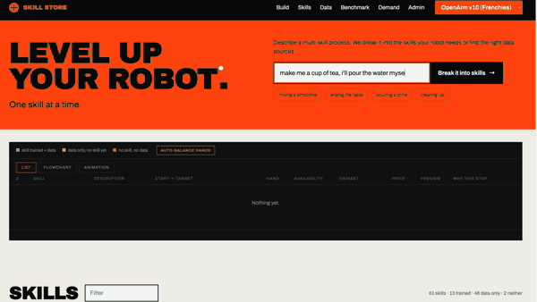

# Cocktail Robotics

**Type what you want. The robot does it.**

Winner of the **Robotics Skills track (Daidai Labs)** at the **ERH Physical AI hackathon**.

<p align="center">
  <a href="media/cocktail.mp4">
    
  </a>
  <br>
  <sub><a href="media/cocktail.mp4">Watch the full demo (1 min 30)</a></sub>
</p>

Teaching a robot a new skill today takes piles of data and a team of engineers. We built the other way
round: an **app store of base skills**, the reliable building blocks that every movement is made of.
You describe your goal, a language model breaks it down into skills from the catalog, and you deploy the
plan on your robot.

## What you see in the video

1. **A sentence.** *"Make me a cup of tea, I'll pour the water myself"* is typed into the Skill Store.
2. **A plan.** The compiler turns it into catalog skills (`locate`, `grasp`, `move`, `release`), each with its
   training data, measured success rate and price. The plan is a program, not a shopping list: €34 in total.
3. **A check.** Before anything moves, a world model replays the plan step by step and the 3D preview shows it.
   An incoherent order, like pouring before grasping, is rejected with the reason.
4. **The robot.** *Deploy on the robot* sends it to our bimanual OpenArm, which grasps the cup and places it.

## How it works

| | Skill Store (the language half) | Robot (the skill half) |
|---|---|---|
| **In** | A request in plain language | Teleoperated demonstrations |
| **Core** | Two-stage compiler: *act it out* as hand movements without seeing the catalog, then *bind* them to real skills | Demonstrations split into the catalog's own atomic skills, one ACT policy per skill, compared against Pi 0.5 |
| **Safety net** | A symbolic simulator checks every plan and sends its complaints back for repair | Measured joint limits, slow ramp-up, speed caps, temperature guard |
| **Out** | A validated, priced plan, plus the *gaps*: missing skills matched to the open datasets that could train them | Learned skills that hand over, torque on, to a scripted pour |

Ratings are **measured, not typed in**: the robot writes its own success rates back to the store after each run.

## Numbers

- **155 compilations** by four planners: the simulator rejects **18%** of first attempts, only **3%** after two repair rounds.
- Searching which hand does what shortens two-arm schedules by **29%**.
- **30 teleoperated demonstrations** (24,412 frames), median tracking error **below 1°** on 12 of 16 joints.
- Slowest control cycle: **11 ms** against a 16.7 ms budget, both cameras running.

The full write-up is in [`paper/main.pdf`](paper/main.pdf).

## Repository

| Folder | What's inside |
|---|---|
| [`skill_store/`](skill_store/) | The web app: compiler, validator, scheduler, catalog, robot runner ([README](skill_store/README.md)) |
| [`scripts/`](scripts/) | Safe teleoperation, recording (LeRobotDataset v3), policy execution, calibration |
| [`skills/pour/`](skills/pour/) | Scripted closed-loop pouring with vision + motor torque |
| [`hardware/`](hardware/) | Minimal Damiao motor protocol over CAN |
| [`remote/policy_space/`](remote/policy_space/) | Pi 0.5 policy server on a Hugging Face GPU |
| [`docs/PIPELINE.md`](docs/PIPELINE.md) | The full robot day: bring-up, recording, training, grasp + pour |
| [`paper/`](paper/) | The paper and its figures |

## Try the Skill Store

No robot and no API key needed: on first start the store loads cached plans for 15 demo prompts.

```bash
cd skill_store
python3 -m venv .venv && .venv/bin/pip install -r requirements.txt
.venv/bin/uvicorn app.api:app --port 8000
```

Then open http://localhost:8000. To compile your own requests, add an Anthropic or OpenAI key to
`skill_store/.env` (see [`skill_store/README.md`](skill_store/README.md)).

## Setup

```bash
uv sync
```

Installs [LeRobot](https://github.com/huggingface/lerobot) (pinned commit, with Feetech + Damiao motor support) and MuJoCo.

## Skills

| Skill | Folder | Role |
|---|---|---|
| pour | [`skills/pour/`](skills/pour/) | Scripted pouring of M&M's (30/60/90 g or a whole bottle) in closed loop with vision + motor torque. Bar state and LLM context for cocktails. |

Each skill takes the shared robot object from the orchestrator and never opens its own CAN
connection, e.g. `from skills.pour import pour` then `pour(robot, 60, "red", ...)`.
Run the pour skill in simulation from the repo root:

```bash
uv run --with-requirements skills/pour/requirements.txt python skills/pour/pour_skill.py --container red --grams 60
```

See [`skills/pour/README.md`](skills/pour/README.md) for details (in French).

## Calibration

`calibration/teleoperators/openarm_mini/` holds the calibration of our OpenArm Mini leader
(`my_openarm_mini_left.json`, `my_openarm_mini_right.json`). It only matches this physical
leader: the homing offsets are also stored in its servos.

Point LeRobot at it with `--teleop.calibration_dir=calibration/teleoperators/openarm_mini`
and `--teleop.id=my_openarm_mini` (bimanual) or `my_openarm_mini_left` / `my_openarm_mini_right` (single arm).
Do not re-run `lerobot-calibrate` on the leader unless needed: its grippers travel more than half a turn and
need a dedicated gripper calibration afterwards.

## Thanks

To the EuroTech Federation, the ESRA (European Student Robotics Association) and the Edelweiss Innovation &
Intelligence Institute (EIII) for organizing the hackathon, to Daidai Labs for the track, to Mathieu Metral for
his coaching, and to the whole Cocktail Robotics team.
